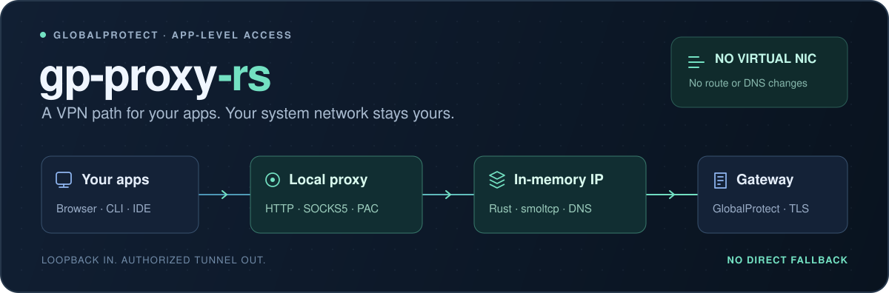

# gp-proxy-rs

**GlobalProtect as a local proxy. Keep your system network yours.**

[](https://github.com/mingmingtsao/gp-proxy-rs/actions/workflows/ci.yml)
[](LICENSE)
[](rust-toolchain.toml)
[](#支持范围)



将 GlobalProtect 转成普通应用可以直接使用的 **HTTP / SOCKS5 代理**。
按域名和网段分流，在隧道断开或认证到期时明确失败。
**不创建虚拟网卡，不修改系统路由、DNS 或防火墙，不启动 OpenConnect。**

[快速开始](#快速开始) · [应用配置](#应用配置) · [分流规则](#分流规则) · [支持范围](#支持范围) · [开发](#开发)

## 能做什么

| 能力 | 行为 |
| --- | --- |
| HTTP / SOCKS5 | HTTP CONNECT、普通 HTTP/1.1 转发、SOCKS5 CONNECT；仅监听 loopback |
| 用户态网络 | smoltcp 在内存中处理 TCP/IP；企业 DNS 也通过隧道解析 |
| PAC 分流 | 已知企业资源交给代理；其余目标由应用使用原有网络 |
| 断线与到期 | 关闭旧连接，有界重连；没有业务流量的宿主网络备用出口 |
| 日常运行 | 显式重新认证、有界磁盘日志、状态查询与带清理回执的停止命令 |

GlobalProtect、TLS 协议、网络栈和代理逻辑使用 Rust。TLS 采用 **rustls + AWS-LC**：
AWS-LC 的 C/汇编密码学原语是明确的语言例外；不使用非 Rust TLS 协议实现或外部 VPN 进程。

## 快速开始

当前实机验证平台为 **macOS arm64**。从源码构建需要 Rust 1.91 与 AWS-LC 的 C/C++ 编译工具；
macOS 可使用 Xcode Command Line Tools。工具链与依赖均已锁定。

```sh
git clone https://github.com/mingmingtsao/gp-proxy-rs.git
cd gp-proxy-rs
cargo build --locked --release
cp gp-proxy.example.toml gp-proxy.toml
```

编辑 `gp-proxy.toml`，填写你的 **Gateway** 和授权域名/网段。Portal 不一定是 Gateway。
最小配置如下；完整选项见 [gp-proxy.example.toml](gp-proxy.example.toml)。

```toml
gateway = "https://vpn.example.com"
http_listen = "127.0.0.1:8080"
socks_listen = "127.0.0.1:1080"
domains = ["corp.example.com"]
networks = ["10.20.0.0/16"]
# ca_file = "/path/to/approved-corporate-ca.pem"
```

```sh
./target/release/gp-proxy check
./target/release/gp-proxy run --username your-user
```

密码通过隐藏终端提示输入。服务以前台进程运行，无需 `sudo`；另开终端使用代理。
企业 CA 可通过 `ca_file` 添加，证书校验不能跳过。端口冲突会在提交认证前报错。

也支持显式加载私有凭据文件：复制 [.env.example](.env.example) 为 `.env`、设置 `chmod 600 .env`，
在本机填写后执行 `./target/release/gp-proxy --env-file .env run`。
文件仅提供账号、密码和网关，不扩大 TOML 的授权范围。不要把密码或 Cookie 放进命令行或版本库。

## 应用配置

| 入口 | 默认地址 |
| --- | --- |
| HTTP 代理 | `http://127.0.0.1:8080` |
| SOCKS5 代理 | `socks5h://127.0.0.1:1080` |
| PAC | `http://127.0.0.1:8080/proxy.pac` |

```sh
curl --disable --noproxy '' --proxy http://127.0.0.1:8080 https://intranet.corp.example.com/
curl --disable --noproxy '' --proxy socks5h://127.0.0.1:1080 https://intranet.corp.example.com/
```

使用 `socks5h` 让目标域名在隧道内解析；`--noproxy ''` 避免环境变量 `NO_PROXY` 绕过代理。
所有入口只接受 loopback 地址。没有本地客户端认证，适用于受信任的个人工作站。

## 日常运行

可以先启动代理入口与磁盘日志，稍后再认证。下面的命令使用同一个配置文件：

```sh
# 终端一：不读取凭据，等待显式认证；日志目录由程序创建。
./target/release/gp-proxy run --wait-auth --log-dir "$PWD/logs"

# 终端二：提交一次认证，然后确认隧道状态。
./target/release/gp-proxy reauth --username your-user
./target/release/gp-proxy status

# 停止服务，等待 JSON 清理回执。
./target/release/gp-proxy stop
```

等待认证、断线与会话到期时，企业请求明确失败。到期后再次执行 `reauth`；
程序不会自动重放密码或应用请求，旧连接需要由应用重建。健康会话上的 `reauth` 返回 busy。

磁盘日志默认循环写入 4 个文件，每个最多 4 MiB，不依赖外部日志观察器。
`status` 退出码 0 表示可用、3 表示已读到不可用状态。
`stop` 退出码 0 表示本地清理完成且已知会话注销均确认；3 表示本地完成但远端结果仍不确定。
Ctrl-C / SIGTERM 也会触发清理；仅凭进程消失不能证明远端注销。

## 分流规则

- 默认只信任配置中的域名后缀和 CIDR，不把所有私网地址视为企业资源。
- `trust_gateway_routes = true` 可显式信任已认证网关下发的分流域名和路由；网关排除规则仍生效。
- 企业 DNS 只使用当前隧道的 DNS 服务。宿主 DNS 仅可用于解析 Gateway 自身的引导地址。
- PAC 不调用 `dnsResolve`，企业项没有 `DIRECT` 备用项；未声明的目标返回 `DIRECT`。首次使用前应审核规则。
- 保留配置旁的 `gp-proxy.pac-history.json` 及 `.lock`；历史分类防止旧企业目标在重启后意外转为直连，但不授予访问权限。

PAC 是应用侧配置，不能约束忽略代理的程序。Chromium 默认可能在 PAC 加载失败时直连；
可显式安装并启用 [严格 PAC 扩展](integrations/chromium-pac)。规则更新后需要刷新，已有连接不会被撤销。
程序不会自动修改系统代理设置。

## 支持范围

实机互通验证覆盖 **macOS arm64、单个授权 Gateway 的用户名密码认证、隧道内 DNS、双代理 HTTPS 及注销**。
另有既往长时间运行和中断恢复观察；这不代表所有 PAN-OS、企业应用或链路条件均已兼容。

| 范围 | 当前边界 |
| --- | --- |
| 平台 | macOS arm64 已实机验证；Linux / Windows 有编译和测试配置，不能等同真实网关验证 |
| 认证 | Gateway 密码路径已实测；Portal Cookie 交接与交互 challenge 仅有合成测试，真实 MFA 未验证 |
| 未实现 | 浏览器 SAML、客户端证书、自动 push 轮询、完整 HIP 报告、ESP-over-UDP、完整 IPv6 数据面 |
| 代理协议 | SOCKS5 仅 CONNECT；普通 HTTP/1.1 单连接单请求，不支持普通 Upgrade，丢弃 trailers；CONNECT 可承载 TLS / WebSocket |
| 性能与部署 | TLS 隧道存在 TCP-over-TCP 限制；macOS 服务管理为可选实验功能，登录自启与后台权限尚未验收 |

本项目为独立实现，与 Palo Alto Networks 无隶属或背书关系。

## 开发

```sh
cargo fmt --check
cargo test --locked
cargo clippy --locked --all-targets -- -D warnings
python3 scripts/check-dependencies.py
node scripts/tests/check-pac.cjs
python3 -m unittest discover -s scripts/tests -p 'test_*.py'
```

普通测试使用合成 TLS 网关和内存网络，不连接企业网关、不创建虚拟网卡。长测与独立互通入口需要显式选择，ignored 不计为通过。
Node / Python 仅用于开发验证；Go 仅用于可选的 [gVisor 互通测试](tests/interop/gvisor)。

源码入口：[GlobalProtect](src/gp) · [会话与重连](src/session.rs) · [内存网络栈](src/stack.rs) · [HTTP / SOCKS](src/proxy.rs) · [授权与 PAC](src/policy.rs) · [DNS](src/dns.rs)

## 许可证

[MIT](LICENSE)。依赖保留各自许可证；见 [依赖清单](docs/dependency-licenses.md)。
随仓库维护的 smoltcp 采用 [0BSD](vendor/smoltcp/LICENSE-0BSD.txt)，[本地 TCP 补丁](docs/smoltcp-patch.md)与上游来源可独立核验。
